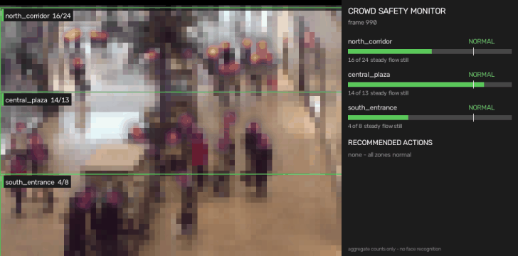
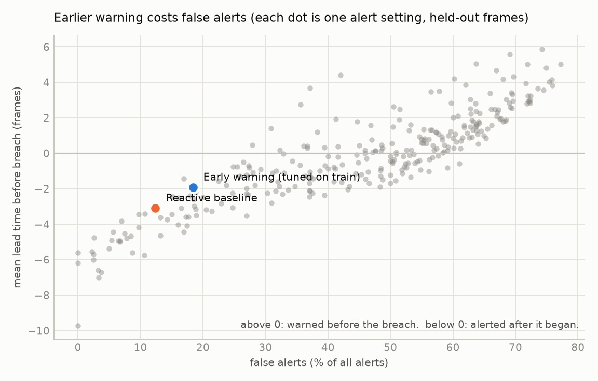
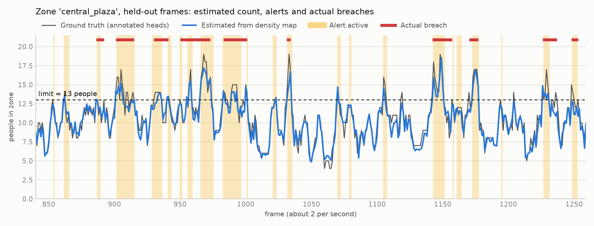

# Crowd Safety Monitor

Estimates crowd density in camera zones, tracks which way the crowd is flowing, alerts when a zone approaches or crosses its safe limit, and has an agent recommend what staff should do about it (open a gate, send someone, hold inflow).

It counts people. It does not identify them: no face recognition, no re-identification, no per-person tracking.



*Mall dataset, held-out frames. Output is pixelated by default so saved video carries no facial detail.*

## What I measured

Everything below is measured on frames the model never saw (Mall dataset, frames 800-1999). Reproduce with `python -m crowdsafe.benchmark`; raw numbers are in [results/benchmark.json](results/benchmark.json).

### Counting

| | |
|---|---|
| Count error per frame (MAE) | **2.26 people** (average frame holds 32) |
| RMSE | 2.87 |
| Baseline: always predict the training average | 4.94 MAE |
| Per-zone MAE | 2.02 / 1.02 / 0.52 people (zones averaging 17 / 11 / 4) |
| Speed | 66 frames per second on a GTX 1650 |

The model undercounts the busiest zone by about 1.7 people on the test frames, which are busier than the training frames. That matters for alerts: a low count is a late alert.

### Alerts: lead time and false-alert rate

A *breach* is a zone at or over its limit for at least 4 frames (about 2 seconds). *Lead time* is how long before the breach an alert was already on; negative means the alert came after the breach began. A *false alert* is one that never overlaps a breach. Exact definitions are in [evaluate.py](src/crowdsafe/evaluate.py).

44 breaches across three zones, 1,200 held-out frames at about 2 frames per second:

| Alert setting | Breaches caught | Warned before breach | Median lead | False alerts |
|---|---|---|---|---|
| Reactive (alert once over the limit) | 91% | 0% | -1.5 frames | 12% |
| Early warning, tuned on training split | 93% | 5% | -1 frame (0.5 s late) | 18% |
| Early warning, eager (smoothing + 5-frame trend) | 100% | 20% | -1 frame | 46% |
| Early warning, tuned, with perfect counts | 98% | 9% | -1 frame | 32% |

**The honest result: this system detects breaches within about half a second, but it does not predict them.** Getting a positive average lead time on this footage costs more than 40% false alerts:



Two things explain it, and both are worth knowing before building on this:

1. **Perception is not the bottleneck.** Feeding the alert logic perfect ground-truth counts barely changes the picture (last row). Occupancy in a zone this size moves like a noisy, mean-reverting series; a trend fitted to the last few seconds says little about the next few.
2. **The dataset has no surges.** It is an ordinary shopping day. Limits were set at the 90th percentile of normal occupancy, so a "breach" here is a busy moment, not an emergency.



### Surge replay

Because the Mall footage never surges, I also replayed 400 simulated scenarios through the same monitor: half are surges that ramp past the limit at 0.2 to 1.6 people per second, half are near misses that stop at 70-90% of the limit. The crowd dynamics are simulated; the counting errors laid on top are the model's real errors on held-out Mall frames. Details and assumptions are in [surge.py](src/crowdsafe/surge.py).

| | Surges missed | Warned before breach | Median lead | False alerts |
|---|---|---|---|---|
| Reactive | 8% | 3% | -1 frame | 7% |
| Early warning (tuned on separate scenarios) | 2% | 22% | 0 frames | 34% |

Same conclusion. The early-warning stage makes detection more reliable (2% missed against 8%), but with realistic count noise it buys almost no advance warning, and its false-alert rate came in above the 30% budget it was tuned to.

### What would actually give lead time

Counting one zone harder will not. The signal has to come from upstream: inflow counted at entrances and gates, occupancy of the zones that feed this one, and scheduled events such as a train arriving or a show ending. The agent already reasons about neighbouring zones and flow direction; the forecaster should too. That is the next thing to build.

## How it works

```
frame -> density map -> zone counts -> alert stage per zone -> agent -> recommended actions
     \-> optical flow -> flow direction per zone ------------/
```

- **Density** ([density.py](src/crowdsafe/density.py)). A ResNet-18 front end with a dilated-convolution head regresses a density map whose sum is the head count, so overlapping people still count. Trained on 800 Mall frames in about 12 minutes on a GTX 1650.
- **Zones** ([zones.py](src/crowdsafe/zones.py)). Polygons in the camera view. A zone's count is the density inside it. Limits come from floor area times a safe density on a real site.
- **Flow** ([flow.py](src/crowdsafe/flow.py)). Dense optical flow, weighted by where the density map says people are, gives each zone a direction and a coherence score (one shared direction or people going every which way). Nobody is tracked.
- **Alerts** ([alerts.py](src/crowdsafe/alerts.py)). NORMAL, WARNING (approaching the limit) and CRITICAL (over it), with confirmation and hysteresis so a count hovering at the limit does not flap.
- **Agent** ([agent.py](src/crowdsafe/agent.py)). Reads zone status and the site layout and recommends actions with a reason for each. A deterministic rule playbook always runs. Optionally Claude re-prioritises and explains ([llm_agent.py](src/crowdsafe/llm_agent.py)): it sees only aggregate numbers, its output is validated against the site layout, it cannot remove a rule-based action, and any error falls back to the rules. The agent recommends; a person decides.

Example output:

```
[frame 991] central_plaza: P1 Open gate G2 - central_plaza at 108% of limit; East side door is closed and adds exit capacity.
[frame 991] central_plaza: P2 Send 2 staff to central_plaza - central_plaza is over its limit; staff on the ground to guide people and confirm the camera reading.
[frame 991] central_plaza: P3 Redirect people towards north_corridor - north_corridor has spare room (67% of limit).
[frame 1001] central_plaza: P2 Hold inflow from south_entrance - Crowd in south_entrance is moving towards central_plaza; meter entry until it clears.
```

## Privacy

- No face recognition, face detection, re-identification or per-person tracking anywhere in the code. It would add legal and privacy risk without making anyone safer.
- The model outputs a density map, not boxes or crops. Flow is measured on pixels, not on individuals.
- The event log holds zone counts, alert levels and recommended actions only.
- Rendered video is pixelated unless you pass `--no-anonymize`.
- The optional Claude advisor is sent numbers and the site layout. Never images.

## Run it

```bash
pip install -e ".[dev]"
```

```bash
python scripts/download_mall.py
```

```bash
python -m crowdsafe.run --start 990 --frames 110 --out runs/demo.mp4
```

Trained weights are included ([weights/mall_density.pt](weights/mall_density.pt), 3.7 MB), so the demo runs without training. To reproduce everything:

```bash
python -m crowdsafe.train --frames 0:800 --out weights/mall_density.pt
```

```bash
python -m crowdsafe.train --frames 0:400 --out runs/fold_a.pt
```

```bash
python -m crowdsafe.train --frames 400:800 --out runs/fold_b.pt
```

```bash
python -m crowdsafe.benchmark
```

```bash
pytest
```

Use `--video your_file.mp4` to run on your own footage, and edit [configs/mall.yaml](configs/mall.yaml) for zones, limits and site layout. Add `--llm` (with `pip install anthropic` and an `ANTHROPIC_API_KEY`) for the Claude advisor.

## Benchmark protocol

- Standard Mall split: train on frames 0-799, test on 800-1999.
- No test data used for model selection: fixed epoch budget, last checkpoint kept.
- Alert settings are tuned on the training split using out-of-fold predictions (a model trained on frames 0-399 predicts 400-799 and the reverse), so tuning sees the kind of counting error the final model makes on unseen frames. The rule: earliest warning with at most 30% false alerts.
- Zone limits and count calibration are derived from training frames only.

## Limitations

- One camera, one scene. The model is trained and tested on the same mall view and will need retraining or fine-tuning elsewhere.
- Limits in the benchmark are occupancy percentiles, not real safety limits. The site layout (gates, staff) in the config is an invented example.
- Flow direction is checked against synthetic motion in the unit tests only; the Mall dataset has no trajectory labels to score it against.
- The Claude advisor is unit-tested with a stand-in client. I have not run it against the live API.
- The surge replay simulates crowd dynamics. Its counting errors are real but taken from a zone of about 17 people; a denser zone would likely see larger errors.
- This is a research project, not a certified safety system. Do not use it as the only safeguard for a real crowd.

## Dataset

Mall dataset: K. Chen, C. C. Loy, S. Gong, T. Xiang, *Feature Mining for Localised Crowd Counting*, BMVC 2012. Released for research use and not redistributed here; `scripts/download_mall.py` fetches it from the authors' page. The demo GIF shows pixelated frames from it.

## Licence

MIT for the code.
